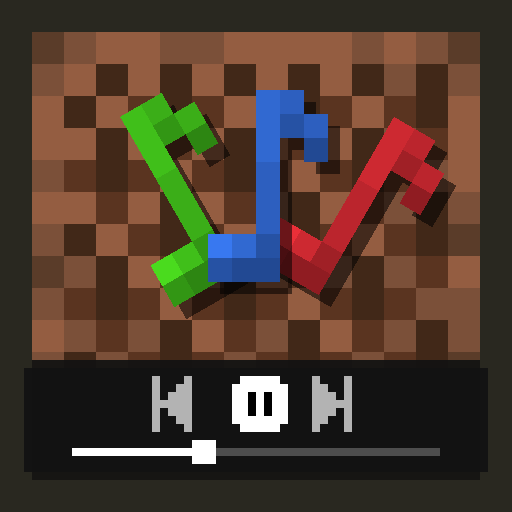

<p align="center"></p>

<h1 align="center">Cue My Music</h1>

<p align="center">A music player for Minecraft's own soundtrack.<br>Fabric &amp; Quilt &nbsp;|&nbsp; 26.3</p>

<p align="center">
<a href="https://modrinth.com/mod/cue-my-music"></a>
<a href="https://www.curseforge.com/minecraft/mc-mods/cue-my-music"></a>
<a href="https://github.com/simply-sunny/cue-my-music/releases"></a>
<a href="LICENSE"></a>
</p>

---

Browse every song in the game by artist or resource pack. Play one and the rest of its page follows, queue up what's next, or like it for later. When you're done, the game takes over exactly as it would without the mod, and the queue shows which song it picked and when it plays. Pitch, speed, and a 6-band equalizer apply to every song. Pitch and speed are separate: drop the music 2 semitones without slowing it down, or play it at 1.2× without raising it.

Only background music is affected. Jukeboxes and sound effects play as normal.

## Install

Client-side only. Servers don't need it.

1. Install [Fabric Loader](https://fabricmc.net/use/) (or Quilt Loader), [Fabric API](https://modrinth.com/mod/fabric-api), and [Mod Menu](https://modrinth.com/mod/modmenu) for your Minecraft version. Mod Menu is required.
2. Put the jar in `mods`.

| Minecraft | Jar | Java | Mod Menu |
| --- | --- | --- | --- |
| 26.3 | `26.3` | 25+ | 21.0.0+ |

Jars are named `cue-my-music-<jar>-<version>.jar`.

## Use

| Action | Default key |
| --- | --- |
| Open player | Unbound. Bind it in Controls. |
| Play/pause music | `F8` on macOS, unbound elsewhere |
| Next song | `F9` on macOS, unbound elsewhere |
| Previous song | `F7` on macOS, unbound elsewhere |
| Turn effects on/off | Unbound |

All keys are rebindable under **Options → Controls → Key Binds → Cue My Music**. They work in game and on any screen without a text box in focus. On a Mac, F7 to F9 are media keys: hold **fn**, or turn on **System Settings → Keyboard → Keyboard Shortcuts → Function Keys → Use F1, F2, etc. keys as standard function keys**.

- Open the player from the music button on the title screen or pause menu, from **Mod Menu → Cue My Music**, or with **Open player**. The same key closes it.
- The library on the left has **All game music**, **Liked Songs**, **Disliked Songs** once you have any, and pages added by add-ons. Below them are three sections: **Artists**, **Packs** (one page per resource pack that adds music), and **Your playlists**. Click a section's heading to fold it away; it shows its count while folded. Scroll the library when it's longer than the window. **Settings** stays at the bottom.
- Click a song to play it. The rest of the page plays after it, in the order shown. The big green button plays the page from the top, or pauses it while it's playing.
- Hover a song and click the heart to like it, or **+** to add it to the queue. **Add all to queue** adds the whole page.
- Right-click a song to queue it, like or dislike it, or add it to a playlist.
- **Dislike** keeps the game from ever picking a song for its own music. If the game is playing it, it skips to another. You can still play it yourself, and it still plays through a page you started. Disliked songs are greyed with a ⊘, and listed on **Disliked Songs**, where right-click → **Remove dislike** brings one back. Liking a song takes its dislike away, and the other way round.
- The repeat button next to play cycles through off, repeat all (the page starts over at its end), and repeat one (the song plays again). Next and previous still move on.
- Click **Title**, **Album**, or the clock to sort. Each click goes up, down, then back to the original order.
- Space plays and pauses while the player is open. Click or drag the progress bar to seek.

### Commands

Client-side, so they work on any server. Songs are named by title, and chat suggests them as you type.

| Command | Does |
| --- | --- |
| `/cmm play <song>` | Plays the song now, then the queue, then the game's music. |
| `/cmm play` | Resumes. |
| `/cmm queue <song>` | Adds the song to the queue. |
| `/cmm next` | Next song. |
| `/cmm prev` | Previous song, or the start of this one. |
| `/cmm pause` | Pauses. |
| `/cmm repeat [off\|all\|one]` | Sets repeat, or cycles it with no argument. |
| `/cmm dislike [song]` | Dislikes the song, or the one playing. Again to take the dislike away. |

A partial title works if only one song matches, such as `/cmm play subwoofer`.

### Playlists

Click **New playlist** in the library, then right-click songs anywhere and pick **Add to** the playlist, or **Add to new playlist** to make one with that song. On a playlist's page, click its name or **Rename** to rename it, and click **Delete** twice to delete it. Right-click a song there to remove it. Playlists are saved with your settings.

### The queue

Queued songs play next, before the rest of the page. The page then picks up after the song the queue interrupted. A song queued while nothing is playing starts at once. Drag to reorder, click × to remove, or double-click to play now. A long queue scrolls.

**Next** plays the queue, then the page, then the game's next song. **Previous** goes back through the page, or restarts the song after its first 3 seconds.

After that, the game's own music returns. The game still decides when music plays: a random break of up to 20 minutes between songs on the default **Music Frequency**, and different music on the title screen, underwater, in the Nether, and so on. The queue shows the game's next song with **In 0:42** while waiting, or **After a 12:30 break** while a song plays. Click it to play it now.

Songs the game starts play exactly as in vanilla, apart from disliked songs: the same weighted pick from `sounds.json` (a disliked song is drawn again, so the rest keep their odds; if every song for the situation is disliked, the game stays quiet until its next break), the same break, each file's own volume and pitch, and the same "Now playing" toast. They still stop when you change dimension or when music that replaces them starts, such as the dragon fight. Songs you pick or queue yourself aren't cut off: they carry on through dimension changes and menus, and while a song is paused the game's music stays quiet.

### Resource packs

A pack that adds or replaces music gets its own page. The album is the pack's name, the art is its icon (or its initials on a gradient if it has none), and the artist is the "By ..." line of its description, or **Unknown artist**.

A pack can name its songs itself with `assets/<namespace>/cuemymusic.json`. Keys are sound files as in `sounds.json`, and any field left out falls back to the above:

```json
{
  "tracks": {
    "mypack:music/rain": { "title": "Rain", "artist": "Someone", "album": "Weather" }
  }
}
```

The player lists every sound event whose name starts with `music.`. Put songs in one the game never plays, such as `mypack:music.extra`, and they play from the player only.

[Cue My Music: Downloads](https://github.com/simply-sunny/cue-my-music-downloads) is a separate add-on that saves songs from a link into such a pack with yt-dlp, from its own page in the player.

## Configure

Open the player and click **Settings**. Changes apply to the song that's playing within a few seconds, which is how much audio the game has already queued. Until then a small ring shows next to the value.

| Setting | Default | Notes |
| --- | --- | --- |
| Effects | On | Turns pitch, speed, and EQ off together. |
| Pitch | 0 | −12 to +12 semitones. 12 is one octave. |
| Speed | ×1.00 | 0.5 to 2.0, in steps of 0.05. |
| Pause during travel | Off | On: your song pauses while a new dimension loads, then resumes from the same spot. Off: it keeps playing, with a brief gap. |
| Use equalizer | Off | Moving a band or picking a preset turns it on. |
| EQ bands | 0 dB | 60, 150, 400, 1k, 2.4k, and 15k Hz, ±12 dB each. |

Presets: Flat, Bass Booster, Bass Reducer, Treble Booster, Treble Reducer, Vocal Booster, and Small Speakers.

Settings, liked and disliked songs, and playlists are saved to `config/cuemymusic.json` in your Minecraft folder:

- **Windows:** `%appdata%\.minecraft\config\cuemymusic.json`
- **macOS:** `~/Library/Application Support/minecraft/config/cuemymusic.json`
- **Linux:** `~/.minecraft/config/cuemymusic.json`

Delete the file to reset to defaults. One value goes further in the JSON than in the screen. Edit it, then restart:

| Key | Default | Notes |
| --- | --- | --- |
| `speed` | `1.0` | Any value from 0.5 to 2.0, to two decimals, such as `1.08`. |

## Develop

Requires JDK 25.

```bash
./gradlew clean buildAll
```

This runs the headless checks (pitch and length on test tones, EQ response on sine waves, pack names, initials, and credits, and the play order rules) and builds the jar into `build/libs/`.

Pitch and speed use a WSOLA time-stretch followed by resampling, and the equalizer is six biquad filters, all in plain Java. The icon and the pause menu button are built from the game's textures by `scripts/MakeIcon.java`:

```bash
java scripts/MakeIcon.java <26.3 client jar> src/main/resources/assets/cuemymusic/icon.png src/main/resources/assets/cuemymusic/textures/gui/sprites/music.png
```

### Add-ons

An add-on can give itself a page in the player's library. Implement `mix.cuemymusic.api.CuePanel` and call `CuePanels.register(panel)` from your client initializer. The page draws through a `PanelCanvas`, which has the player's header, headings, text, text fields, buttons, progress bar, and song list, so it matches the rest of the player. A panel can also take over a resource pack's entry (`packId`) and add items to the right-click menu of its songs (`songActions`). The API is new in 1.1.0 and may still change.

## Troubleshooting

| Problem | Fix |
| --- | --- |
| `requires modmenu` | Install Mod Menu for your Minecraft version. |
| Open player key does nothing | Bind **Open player** under Controls. |
| F7–F9 change brightness or volume | Hold **fn**, or turn on standard function keys in macOS settings. |
| A change doesn't apply | Wait for the ring next to it to go. Already-queued audio plays out first. |
| Seek is slow on a long song | Seeking decodes up to that point. Far into a 6-minute song can take a moment. |
| A pack's songs are missing | The pack points at files that don't exist in this version. Vanilla can't play them either. |
| Jukebox isn't affected | Expected. Only background music is. |
| Broken config | Delete `config/cuemymusic.json` and relaunch. |

Logs are in `.minecraft/logs/latest.log`. Include the log and your Minecraft, mod, and loader versions when you report an issue.

## Limits

- **Sound effects and jukeboxes:** not affected, only background music.
- **Other music mods:** mods that replace the music stream, such as custom players or radios, may bypass it.
- **Extreme settings:** pitch and speed sound best within about ±5 semitones and 0.75–1.5×. Beyond that you'll hear some smearing or echo.

## License

MIT, see [LICENSE](LICENSE). Copyright © 2026 Saunak Karnati (simply-sunny).

The icon and the pause menu button are made from Minecraft's note block, note particle, and "Now playing" textures. Minecraft is a trademark of Mojang Studios.
